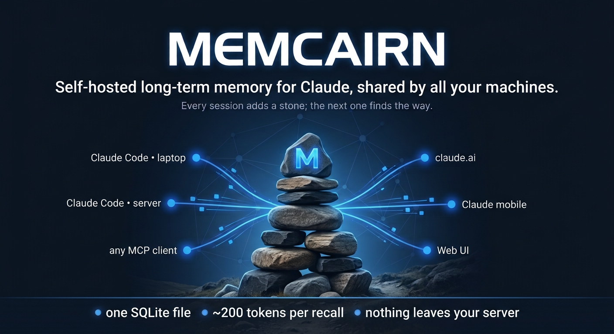

# Memcairn



Long-term memory for Claude Code (and other MCP clients) that you host yourself, shared by
all your machines.

*A cairn is the pile of stones hikers leave to mark a trail. Every session adds a stone;
the next one finds the way.*

Claude Code already remembers how you like to work (`CLAUDE.md`, auto memory), but only
on one machine, and only what fits into every session. Memcairn adds the rest: facts
about your projects, servers, decisions and todos, searched when needed, the same on
your laptop, your server and the Claude phone app.

## Install

Paste this into Claude Code:

> Install Memcairn for me, following https://github.com/shanislav/memcairn/blob/main/INSTALL.md

Claude asks whether the memory should stay on this computer or be shared through a
server, sets it up and checks that it works. You never copy a token: machines connect
with a one-time code. [INSTALL.md](https://github.com/shanislav/memcairn/blob/main/INSTALL.md) is what Claude follows; you can follow it
yourself just as well.

The short version:

```bash
# only this computer
uv tool install "memcairn[vector]"
memcairn connect --local

# several computers: run the server (Docker, see docs/setup.md), then connect each machine
docker compose up -d && docker compose exec memcairn memcairn login-link   # web UI
memcairn pair https://memory.example.com K7QM-42XD    # code from "Add machine"
```

## What you get

- **A short overview at every session start**: what memory covers (topics, documents),
  the facts you pinned and how many todos are open, ~200 tokens plus your pinned facts.
  Claude then recalls what the task needs.
- **Small context cost.** About 1,650 tokens per session in all: the tool list (~980),
  the usage rules (~470) and the overview (~200). A recall returns five one-line hits
  (~190 tokens), full text only for what the model asks for.
- **Writes are instant**: no LLM call when storing.
- **Nothing is lost silently**: every change is versioned, outdated facts are superseded
  rather than overwritten, todos are closed as done or dropped.
- **Shared documents** (a server inventory, plans) synced to the files you choose, with
  three-way merge; optionally Claude Code's own auto memory carried between your
  machines.
- **A web UI** to browse, search, edit and clean up memory, add machines and revoke them.
- **claude.ai and the Claude apps** through a built-in OAuth server (opt-in).
- **Any language**: inflections, missing diacritics, Chinese and Japanese (no spaces),
  and with the local model, a query in one language finds a fact in another.
- **Only you pin**: pinned facts reach every session on every machine, so an agent can
  only ask for a pin; you approve it in the web UI.
- **Credentials are refused** on write; `memcairn purge` removes a leaked one for good.
- **One SQLite file, no LLM.** Search by meaning uses a small local model (~0.6 GB of
  memory, optional: without it ~0.1 GB, words only); nothing goes to an external service.

## How well it finds things

Three tests, all reproducible ([method, numbers and caveats](https://github.com/shanislav/memcairn/blob/main/BENCHMARK.md)).
"Found" means the right fact is among the five lines recall returns.

| | found | compared with |
|---|---|---|
| 998 real facts, 50 queries (the author's memory) | **100%**, ~190 tokens per query | official `server-memory`: 24%, ~2,055 tokens |
| [LoCoMo](https://github.com/snap-research/locomo), 1,540 questions over long conversations | **60%** | plain BM25: 54%, plain vector search: 38% |
| 92 facts in nine languages, 101 queries | **95%** | plain BM25: 88% |

LoCoMo measures retrieval only (is the evidence among the results), not answers written
by an LLM, so it can't be compared with the answer scores other systems publish.

## Documentation

- [INSTALL.md](https://github.com/shanislav/memcairn/blob/main/INSTALL.md): installation, step by step
- [docs/setup.md](https://github.com/shanislav/memcairn/blob/main/docs/setup.md): the full guide (server, clients, web UI, documents and
  sync, security, migration, troubleshooting)
- [DESIGN.md](https://github.com/shanislav/memcairn/blob/main/DESIGN.md): how it works and why
- [BENCHMARK.md](https://github.com/shanislav/memcairn/blob/main/BENCHMARK.md): how well it finds things, and how that was measured
- [COMPARISON.md](https://github.com/shanislav/memcairn/blob/main/COMPARISON.md): other memory systems
- [ROADMAP.md](https://github.com/shanislav/memcairn/blob/main/ROADMAP.md): what comes next
- [CHANGELOG.md](https://github.com/shanislav/memcairn/blob/main/CHANGELOG.md): what changed

## Development

```bash
uv venv && uv pip install -e ".[dev]"
uv run pytest
uv run python bench/multilingual.py      # recall in nine languages, no download
```

MIT license.
